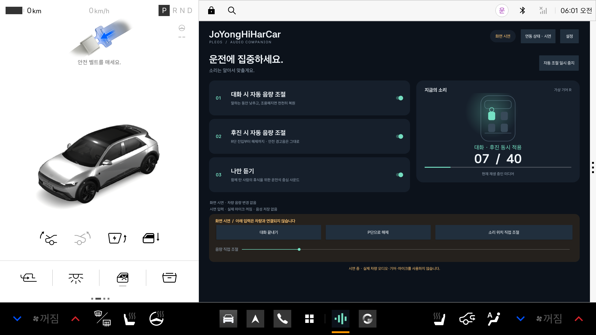

# JoYongHiHarCar

**운전에 집중하세요, 소리는 알아서 맞출게요.**

대화가 시작되면 음악을 낮추고, R단에 들어가면 낮은 음량을 유지하며, 동승자가 쉴 때 운전석 중심으로 소리를 옮기는 차량 오디오 서비스를 제안합니다.

**현재 APK는 오디오 자동 조절 경험을 보여 주는 시연용 프로토타입입니다. 화면 시연의 음량 숫자와 페이더·밸런스는 가상 값이며, 다른 앱의 음악·라디오나 실제 차량 스피커 음량을 바꾸지 않습니다.** 에뮬레이터의 실제 R/P 기어 신호 수신과 짧은 마이크 입력·백그라운드 캡처는 별도로 검증했습니다. 실차의 미디어 음량·소리 위치 제어에는 제조사 승인과 추가 연동이 필요합니다.

- [설치용 release APK](apk/JoYongHiHarCar_release.apk)
- [개발 현황과 후속 개발 계획](docs/development-plan.md)
- [검증 기록](evidence/verification.md)
- [SDK와 권한 조사](docs/research/pleos-api-findings.md)

## 제안 기능과 현재 구현 범위

| 기능 | 제안하는 사용자 경험 | 현재 APK에서 확인할 수 있는 동작 |
| --- | --- | --- |
| 대화 시 자동 음량 조절 | 운전자·동승자가 말하면 현재 재생 중인 미디어를 낮추고 대화 종료 후 복원 | 시연 버튼으로 발화 시작·종료를 입력하면 가상 음량이 변함. 실제 마이크 모드에서는 실험용 활동 감지 상태를 표시하지만 차량 음량은 제어하지 않음 |
| 후진 시 자동 음량 조절 | 경고음 발생 여부와 관계없이 R단 진입부터 미디어 음량을 낮춤 | 시연에서는 가상 P/R 버튼으로 음량 정책을 확인. 별도 실제 연동 모드에서는 Pleos 에뮬레이터 R/P 신호를 읽을 수 있음 |
| 나만 듣기 | 운전자가 직접 선택하면 전후 페이더와 좌우 밸런스를 운전석 중심으로 이동 | 운전석 강조 그림과 가상 페이더·밸런스로 표현. 실제 스피커 위치는 변경하지 않음 |
| 조건 중첩 | 대화와 후진이 겹쳐도 음량을 중복해서 계속 낮추지 않음 | 기준 음량에 더 강한 감소율 하나를 적용하고 두 이유를 함께 표시 |
| 수동 조작 우선 | 사용자가 바꾼 볼륨·소리 위치를 자동 설정이 덮어쓰지 않음 | 가상 음량의 수동 변경과 페이더·밸런스의 축별 수동 변경 보존 |
| 일시 중지·재개 | 자동 개입을 멈추고, 재개 시 현재 조건을 반영 | 소유 중인 가상 음량을 부드럽게 복원하고 소리 위치를 정리. 재개 시 선택된 기능과 현재 R 상태를 다시 반영 |

새 음악 플레이어, 음성 전사·대화형 AI, 동승자 수면 자동 감지는 구현 범위에 포함하지 않습니다. 안전 경고음·주차 경고음·내비게이션 안내를 함께 낮추는 동작도 서비스 목표가 아닙니다.

## 화면 시연과 실제 연동의 구분

| 구분 | 입력 | 출력과 한계 |
| --- | --- | --- |
| 화면 시연 | 앱의 대화 시작/끝내기, R단 진입/P단으로 해제 버튼 | 가상 음량 0~40, 소리 위치 그림, 작동 이유. 실제 차량·다른 앱의 미디어·마이크를 사용하지 않음 |
| 에뮬레이터 기어 연동 | 공식 Pleos Virtual Console → AAOS GEAR_SELECTION → 앱 콜백 | 실제 에뮬레이터 R/P 수신을 확인. 오디오 특권이 없어 그 신호로 실제 미디어 음량을 낮추지는 못함 |
| 실제 마이크 감지 | 사용자가 권한을 허용하고 화면에서 기능을 켠 뒤 AudioRecord 입력 | 실험용 발화 활동 상태. 보컬·라디오·내비 안내와의 구분, 모든 좌석, 장시간 동작은 미검증 |
| 실차 오디오 제어 | 향후 제조사 승인 어댑터 | 현재 미지원. 차량 미디어 그룹 제어 및 원래 페이더·밸런스 읽기·복원 API 검증 필요 |

화면 시연의 가상 R 버튼과 Virtual Console의 실제 에뮬레이터 기어 조작은 별개입니다. 실제 마이크 모드에서 말을 하는 것만으로 화면 시연 버튼이 눌리거나 다른 앱의 음악이 작아지는 것은 아닙니다.

## 빠른 시연 준비

1. APK를 설치한 Pleos 에뮬레이터에서 **JoYongHiHarCar**를 엽니다.
2. 처음에는 실제 연동 확인 모드가 표시됩니다. 오디오 항목의 **제조사 승인 차량 오디오 권한 없음**은 현재 지원 범위를 알리는 정상적인 제한 표시입니다.
3. **연동 상태 · 시연 → 화면 시연 시작**을 선택합니다.
4. 화면 상단의 **화면 시연** 표시와 하단의 가상 입력 안내를 확인합니다.
5. 새 시연 세션의 시작 음량은 **28/40**, 가상 기어는 **P**, 세 기능은 꺼짐입니다.
6. 가상 P단에서 **설정**을 열어 아래 기본값을 확인합니다. 이전에 저장한 설정은 유지되므로 시연 수치를 재현하려면 값을 맞춥니다.
7. **대화 시 자동 음량 조절**, **후진 시 자동 음량 조절**, **나만 듣기**를 켭니다.

이미 시연을 사용 중이면 **연동 상태 · 시연 → 실제 연동으로 돌아가기 → 화면 시연 시작**으로 가상 음량과 기능 상태를 새로 시작할 수 있습니다.

| 설정 | 기본값 | 조절 범위 |
| --- | --- | --- |
| 대화 시 감소 정도 | 65% 낮추기, 기준 음량의 35% 유지 | 10~90% 낮추기 |
| 후진 시 감소 정도 | 75% 낮추기, 기준 음량의 25% 유지 | 10~90% 낮추기 |
| 대화 종료 후 복원 대기 | 침묵 3초 | 1~10초 |
| 운전석 집중 정도 | 70% | 10~90% |

세부 설정은 **P단 확인 시에만** 열립니다. 기어를 읽을 수 없으면 정차 상태로 가정하지 않습니다.

## 기능별 시연 순서

아래 숫자는 시작 음량 28/40과 기본 설정을 기준으로 한 예시입니다. 가상 음량은 정수로 반올림됩니다.

### 1 대화가 시작되고 끝나는 경우

다른 감소 조건이 없는 가상 P단에서 진행합니다.

| 조작 | 화면에서 확인할 결과 |
| --- | --- |
| 대화 자동 조절을 켜고 **대화 시작** | 약 0.4초에 걸쳐 28 → 10으로 감소. **대화 중** 표시 |
| 대화 상태를 유지 | 가상 음량 10 유지 |
| **대화 끝내기** | 약 3초 동안 대화 종료 여부를 기다리며 낮은 음량 유지 |
| 기다리는 중 다시 **대화 시작** | 복원 대기를 취소하고 낮은 음량 유지. 다시 끝내면 마지막 종료부터 대기 시간을 새로 계산 |
| 재개하지 않고 기다리기 | 버튼을 누른 뒤 약 3.5초부터 음량 상승, 약 5.3초에 기준 음량 28로 복원 완료 |

화면 시연에서는 실제로 말할 필요가 없습니다. 대화 버튼이 발화 감지 신호를 대신합니다.

### 2 R단에 들어갔다가 P단으로 돌아오는 경우

대화 입력이 꺼진 상태에서 진행합니다. 앞 시연의 복원이 끝난 뒤 시작하면 수치를 확인하기 쉽습니다.

| 조작 | 화면에서 확인할 결과 |
| --- | --- |
| 후진 자동 조절을 켜고 **R단 진입** | 약 0.4초에 걸쳐 28 → 7로 감소. **후진 중** 표시 |
| R단 유지 | 경고음 유무와 관계없이 가상 음량 7 유지 |
| **P단으로 해제** | 약 1.2초 동안 후진 해제 상태를 유지해 짧은 기어 전환으로 인한 출렁임을 줄임 |
| 다시 R단에 들어가지 않고 기다리기 | P 전환 후 약 1.7초부터 음량 상승, 약 3.5초에 기준 음량 28로 복원 완료 |
| 복원 대기 중 다시 **R단 진입** | 복원을 취소하고 후진 기준의 낮은 음량 유지 |

실제 정책의 종료 조건은 **R단에서 벗어남**입니다. 시연 화면은 이를 P단 복귀 버튼으로 보여 줍니다.

### 3 대화와 후진이 겹치는 경우

1. 기본 음량 28에서 **대화 시작**을 누르면 약 10이 됩니다.
2. **R단 진입**을 누르면 약 7이 되고 **대화 · 후진 동시 적용**을 표시합니다.
3. **대화 끝내기**를 눌러도 R단이면 7을 유지합니다. 대화가 끝났다는 이유만으로 기준 음량으로 올리지 않습니다.
4. 대화의 침묵 대기가 끝난 뒤 **P단으로 해제**하면 후진 해제 대기와 복원 절차를 거쳐 28로 돌아갑니다.
5. 반대 순서로 P단에 먼저 복귀해도 대화가 남아 있으면 기준 음량 28로 복원하지 않습니다. 후진 해제 유지 시간이 끝나면 대화 목표인 약 10을 유지합니다.

감소율을 곱하지 않습니다. 28 × 35% × 25%가 아니라, 두 조건 중 더 낮은 잔여 비율인 **25%를 한 번 적용해 7**로 맞춥니다. 최종 복원은 두 조건의 유지 시간이 모두 끝난 뒤 진행하며, 대화·후진 대기 시간을 단순히 합산하지 않습니다.

### 4 나만 듣기와 수동 조작

- **나만 듣기**를 켜면 차량 그림의 운전석을 강조하고 가상 페이더는 앞쪽, 밸런스는 왼쪽으로 옮깁니다. 왼쪽 운전석을 가정한 시연입니다.
- 이 상태에서 대화·후진 입력을 주면 소리 위치는 유지하고 가상 음량만 낮춥니다.
- 모드를 끄면 모드 진입 전 위치로 복원합니다.
- **소리 위치 직접 조절**에서 한 축을 바꾸면 그 축은 사용자의 값을 보존합니다. 예를 들어 밸런스만 직접 변경했다면 모드 해제 시 페이더만 원래 값으로 복원합니다.
- 자동 감소 중 **음량 직접 조절**을 사용하면 해당 상황이 완전히 끝날 때까지 자동 볼륨 개입을 양보합니다. 상황이 끝나도 예전 28로 강제 복원하지 않습니다. 다음 상황에서는 사용자가 정한 새 음량을 기준으로 삼습니다.
- **자동 조절 일시 중지**는 자동 개입을 멈추고 소유 중인 가상 음량을 약 1.8초에 걸쳐 복원합니다. 수동 변경이 있으면 그 값을 존중합니다. 재개 시 현재 R 상태와 선택된 기능을 다시 반영합니다.

나만 듣기는 가상 위치 조절 시연이며, 다른 좌석을 완전히 차음하거나 잠든 동승자를 자동 감지하는 기능이 아닙니다.

## 대화 종료와 P단 복귀 후 몇 초를 기다리나요

**아래 시간은 다른 감소 조건이 없고 사용자가 음량을 직접 바꾸지 않았을 때의 기본 설정입니다.**

| 종료 상황 | 낮은 음량 유지 | 추가 복원 대기 | 상승 시작 시점 | 부드럽게 올리는 시간 | 기준 음량 복원 완료 |
| --- | --- | --- | --- | --- | --- |
| 시연의 **대화 끝내기** | 침묵 3.0초 | 0.5초 | 종료 버튼 후 약 **3.5초** | 1.8초 | 종료 버튼 후 약 **5.3초** |
| 시연의 **P단으로 해제** | R 해제 유지 1.2초 | 0.5초 | P 전환 후 약 **1.7초** | 1.8초 | P 전환 후 약 **3.5초** |

- 설정의 **대화 종료 후 복원 대기**는 첫 번째 행의 침묵 시간입니다. 설정이 S초이면 상승 시작은 약 S + 0.5초, 복원 완료는 약 S + 2.3초입니다.
- R 해제 유지 1.2초, 추가 대기 0.5초, 감소 램프 0.4초, 복원 램프 1.8초는 현재 코드의 고정 기본값입니다. 설정 화면에서 바꾸는 항목은 아닙니다.
- 복원 대기 중 대화나 R단이 재개되면 복원을 취소합니다. 다른 조건이 남아 있으면 그 조건의 낮은 목표 음량을 유지합니다.
- 실제 마이크 감지는 마지막 음성 후보 이후 약 0.6초를 더 기다려 종료를 판정합니다. 그 종료 신호에 같은 정책을 연결하면 기본 완전 복원까지 약 5.9초 전후가 예상되지만, **현재 APK는 실제 마이크로 차량 음량을 제어하지 않으며 이 수치는 실차 음량 복원의 실측값이 아닙니다.**
- Android 처리 주기, 정수 반올림, 에뮬레이터 부하에 따라 표시 시점에는 작은 차이가 있습니다.

기본값과 계산 근거는 [AudioPolicy](app/src/main/java/ai/pleos/quietdrive/AudioPolicy.java), [서비스의 입력 전달](app/src/main/java/ai/pleos/quietdrive/AutomationService.java), [마이크 종료 판정](app/src/main/java/ai/pleos/quietdrive/VoiceMonitor.java)에 있습니다.

## 실제 에뮬레이터 기어 연동을 확인하려면

1. 에뮬레이터를 실행하고 앱은 **실제 연동 모드**에 둡니다.
2. 아래 시작 스크립트로 포트를 연결한 뒤 브라우저에서 [Pleos Virtual Console](http://127.0.0.1:8088/)을 열어 둡니다.
3. 콘솔의 기어를 R/P로 변경하면 앱의 **에뮬레이터 기어 R/P** 표시가 바뀝니다.
4. 시험 후에는 콘솔 기어를 P로 복귀시킵니다.

콘솔은 브라우저 세션의 주기적인 연결 신호로 DDS 브리지를 활성화합니다. 페이지를 닫거나 세션이 비활성화되면 HTTP 503 emulator_inactive가 발생할 수 있습니다. 이 연동은 [기어 콜백 3개 검증](evidence/gear-app-callback.txt)으로 확인했으며, 실제 미디어 음량은 특권 미부여로 변경되지 않습니다. 자세한 절차는 [콘솔 검증 기록](evidence/console-bridge.txt)을 참고하세요.

## 마이크 감지와 개인정보

화면에서 실제 연동 모드의 대화 기능을 켜고 마이크 권한을 허용한 뒤에만 입력 장치를 시작합니다. 사용 중 상태와 중지 알림을 표시합니다. 사용자가 시작한 microphone foreground service로 다른 앱을 사용하는 동안 감지를 이어갈 수 있게 구성했습니다.

입력은 16 kHz mono PCM을 메모리에서 분석합니다. 음성 파일·대화 내용·전사 결과를 저장하거나 네트워크로 보내지 않으며 앱에는 인터넷 권한이 없습니다. 기능을 끄거나 일시 중지하면 마이크를 해제합니다.

현재 감지는 적응형 에너지와 zero-crossing 기반의 **실험용 활동 감지**입니다. 모든 좌석의 발화, 보컬·라디오 진행자·내비 안내와의 분리, 장시간 백그라운드 안정성은 검증하지 않았습니다. 시험 이미지에는 AEC와 잡음 억제 효과가 제공되지 않았습니다. 따라서 정확한 탑승자 음성 분리 기능으로 소개해서는 안 됩니다.

## 오디오 제어에 권한이 필요한 이유

공개 Pleos Vehicle SDK에는 Audio/Powertrain 도메인이 문서화되어 있지 않습니다. 기어 읽기는 표준 AAOS의 normal 권한인 CAR_POWERTRAIN과 GEAR_SELECTION을 사용해 에뮬레이터에서 확인했습니다. 기어를 바꾸는 CONTROL_CAR_POWERTRAIN 권한은 사용하지 않습니다.

차량 미디어 그룹의 CarAudioManager 제어에는 signature/privileged 권한인 CAR_CONTROL_AUDIO_VOLUME이 필요합니다. 페이더·밸런스 제어에는 CAR_CONTROL_AUDIO_SETTINGS와 원래 값을 신뢰할 수 있게 읽고 복원할 제조사 계약이 필요합니다. 일반 APK에 권한 이름을 적는 것만으로 특권이 부여되지는 않습니다.

일반 배포용 publicApp에는 특권 오디오 제어 권한을 선언하지 않습니다. oem 변형은 향후 승인된 통합 개발용 manifest이며 배포 APK로 제공하지 않습니다. 실제 어댑터는 미디어 그룹이 내비게이션·안전음과 분리되는지 검사하도록 구성했지만, 물리 스피커 제어는 검증하지 않았습니다.

- [Pleos SDK 정책](https://document.pleos.ai/docs/pleos-only/connect-sdk-pleos/)
- [Android 차량 권한](https://developer.android.com/reference/android/car/Car)
- [권한과 API 조사 결과](docs/research/pleos-api-findings.md)

## 설치와 빌드

| 항목 | 기준 |
| --- | --- |
| APK | [apk/JoYongHiHarCar_release.apk](apk/JoYongHiHarCar_release.apk) |
| 언어 | Java 17. 공식 Android/Pleos API 연동을 위해 선택 |
| Android | min API 28, compile/target API 34 |
| 빌드 도구 | Gradle wrapper 8.9, Android Gradle Plugin 8.7.3, Build Tools 34.0.0 |
| 검증 에뮬레이터 | Pleos Connect v2.1.0 ARM64, Android 14/API 34 |
| 화면 | 전체 2560×1440, 160 dpi, Pleos 기본 화면 내부 앱 영역 |
| Mac 권장 실행 설정 | cold boot, 4 GB RAM, host GPU, Vulkan 비활성화 |

~~~sh
./scripts/build.sh
./scripts/environment/start-pleos-emulator.sh
./scripts/install.sh emulator-5554
~~~

시작 스크립트는 **이미 설치된** Pleos AVD를 실행합니다. 다른 컴퓨터에서는 먼저 [공식 에뮬레이터 설치 안내](https://document.pleos.ai/docs/connect/guide/getting-started/application-development/setup-connect-sdk-emulator)에 따라 SDK·이미지·AVD를 준비하세요. 현재 환경의 설치 기록과 그래픽 문제 해결은 [환경 문서](docs/research/emulator-setup.md)에 있습니다.

Android Studio에서 저장소 폴더를 열어도 됩니다. SDK 기본 위치는 macOS의 ~/Library/Android/sdk이며 다른 환경에서는 ANDROID_HOME 또는 local.properties를 설정합니다. 외장 exFAT의 macOS 메타데이터가 리소스로 혼입되는 문제를 피하려고 빌드 산출물은 기본적으로 ~/.cache/quiet-drive/build에 저장합니다. QUIET_DRIVE_BUILD_ROOT로 바꿀 수 있습니다.

빌드 스크립트는 처음 실행할 때 로컬 개발·시연용 서명 키를 생성합니다. .signing/과 local.properties는 Git에 포함하지 않습니다. 실제 배포에는 별도로 관리하는 배포 서명 키를 사용해야 합니다. Debug 설치본과 release 설치본의 서명이 다르면 이 앱의 기존 설치본을 제거한 뒤 설치해야 하며, 제거하면 이 앱의 설정이 초기화됩니다.

내부 패키지 ai.pleos.quietdrive와 일부 검증 기록의 Quiet Drive 표기는 이전 프로젝트 이름입니다. 현재 앱의 표시 이름과 배포 APK는 **JoYongHiHarCar**입니다.

## 검증과 한계

~~~sh
./scripts/test-policy.sh
./scripts/test-device.sh emulator-5554
./gradlew :app:lintPublicAppDebug :app:lintPublicAppRelease
~~~

device 테스트 스크립트는 연결된 에뮬레이터에 debug APK를 설치합니다. release 설치본과 서명이 다르면 앞서 설명한 설치본 제거가 필요합니다. 대화·후진 음량 검증에는 명시적인 시연 입력을 사용합니다.

| 검증 | 기록된 결과 |
| --- | --- |
| 정책 엔진 | Java 17 -Xlint:all -Werror, 80개 assertion 통과 |
| 에뮬레이터 서비스 통합 | 시연 입력으로 26개 check 통과 |
| 실제 기어 수신 | 공식 Console → AAOS → 앱 R/P 콜백 3개 check 통과 |
| 마이크 권한 거부 | 토글 비활성화·캡처 차단 2개 check 통과 |
| 마이크 생명주기 | 소프트웨어 그래픽 모드에서 비영 입력, 약 3초의 짧은 백그라운드 유지, 명시적 중지 확인 |
| release 빌드·서명 | 빌드 및 APK 서명 검증 통과 |
| 화면 터치 | 시연 전환·세 토글·동시 감소 7/40·설정 네 슬라이더 확인 |

[상세 검증 기록](evidence/verification.md)에는 결과 파일과 환경 제약을 함께 남겼습니다. 실제 차량 스피커의 음량·페이더, 안전 경고음 분리, 전체 좌석 검출, 장시간 마이크 감지와 보컬·라디오·내비 오인 방지 성능은 미검증입니다.

정상 중지 시 소유 중인 설정을 복원하도록 구현했지만, 차량 연결 단절·OS 강제 종료·전원 차단 이후 복원을 보장하지 않습니다. 연결을 잃으면 직접 음량 확인 안내를 표시하고, 기어 읽기 실패를 R단 해제로 해석하지 않습니다.

## 후속 개발

다음 단계는 제조사 승인 오디오 연동, 원래 소리 위치 읽기·복원 계약 확보, 차량 마이크/AEC 참조를 이용한 오인 감소, 실차 검증입니다. 단계별 산출물과 완료 기준은 [개발 계획](docs/development-plan.md)에 정리했습니다.
